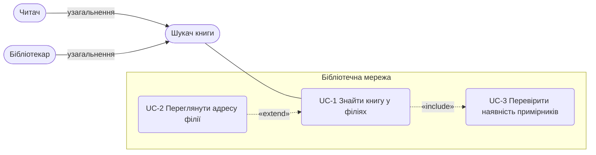

# Діаграма Use Case: пошук книги

## Пояснення
- Читач і Бібліотекар є різновидами абстрактного актора «Шукач книги», бо шукають однаково.
- UC-3 завжди входить до UC-1 (`include`): без перевірки наявності пошук не має сенсу.
- UC-2 додається до UC-1 лише за бажанням актора (`extend`): адресу філії дивляться не завжди.
