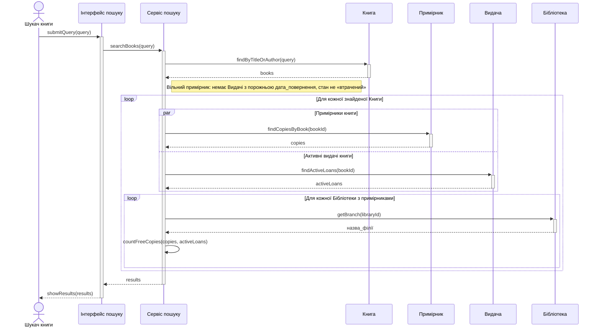

# S1: Книга знайдена, є вільні примірники

## Пояснення
- Сервіс пошуку шукає Книги, а потім для кожної паралельно (par) бере Примірники та активні Видачі.
- У вкладеному циклі по Бібліотеках рахується кількість вільних примірників.
- Смуги Інтерфейсу та Сервісу починаються до фрагментів і закінчуються після них.
