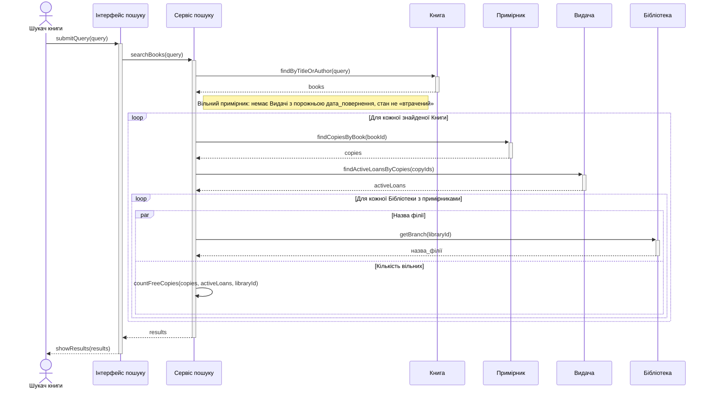

# S1: Книга знайдена, є вільні примірники

## Пояснення
- Видача пов'язана лише з Примірником, тому активні видачі шукаємо за примірниками книги, після того як їх отримано.
- Паралельними (par) є тільки незалежні кроки: взяти назву філії та порахувати вільних.
- Смуги Інтерфейсу та Сервісу починаються до фрагментів і закінчуються після них.
