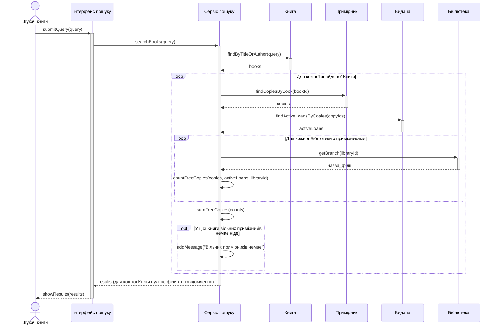

# S2: Книга є в каталозі, але вільних примірників немає

## Пояснення
- Пошук такий самий, як у S1, але всі примірники видані, тому лічильники дорівнюють 0 (FR-3).
- Перевірка «вільних немає ніде» виконується всередині циклу, окремо для кожної Книги, і додає повідомлення (FR-4).
- Смуга Сервісу пошуку триває через увесь цикл і закінчується після нього.
