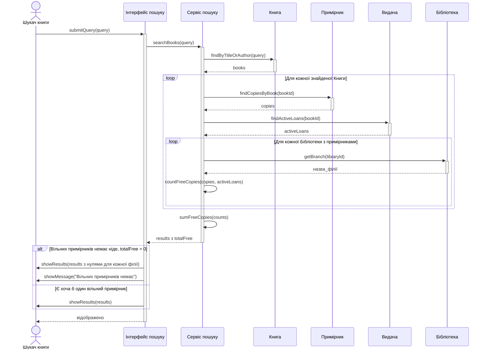

# S2: Книга є в каталозі, але вільних примірників немає

## Пояснення
- Пошук такий самий, як у S1, але всі примірники видані, тому лічильники дорівнюють 0.
- Після циклів Сервіс рахує загальну кількість вільних. Якщо вона 0, Інтерфейс показує нулі по філіях і повідомлення (FR-3, FR-4).
- Смуга Інтерфейсу триває через увесь фрагмент alt і закінчується після нього.
