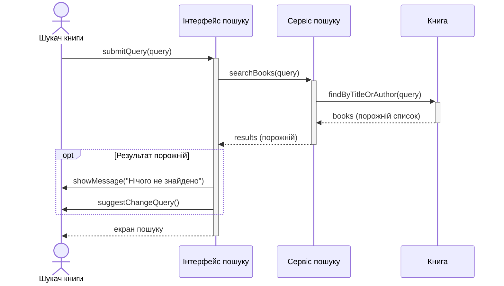

# S3: Книги з таким запитом немає

## Пояснення
- Книг за запитом немає, тому Сервіс повертає порожній результат, а не помилку.
- Інтерфейс показує реакцію на порожній результат у фрагменті opt (FR-5). Гілку з результатами тут не дублюємо, вона є в S1. Його смуга активності не обривається всередині фрагмента.
