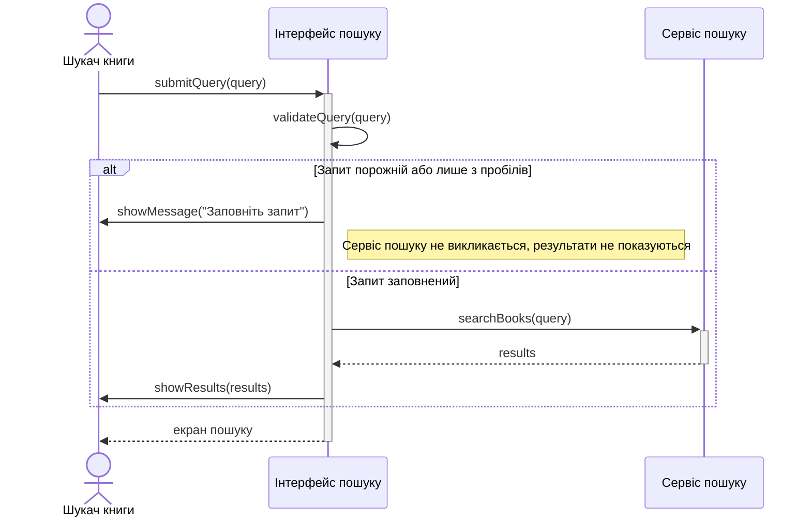

# S4: Порожній запит

## Пояснення
- Інтерфейс сам перевіряє запит (self-call validateQuery), тому в помилковій гілці до Сервісу пошуку нічого не йде (FR-6).
- Смуга Інтерфейсу триває до фрагмента, через увесь alt і закінчується після нього.
