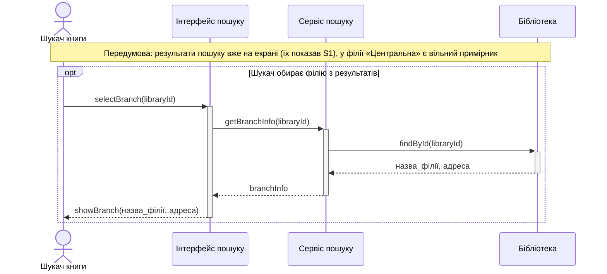

# S5: Перегляд адреси філії з вільним примірником

## Пояснення
- Перегляд адреси необов'язковий (extend до UC-1), тому його показано фрагментом opt (FR-7).
- Результати вже на екрані з S1, тому окремого кроку перегляду немає, а передумова записана в Note.
- Інтерфейс працює лише всередині фрагмента, тож його смуга активності починається й закінчується там, вкладених смуг немає.
