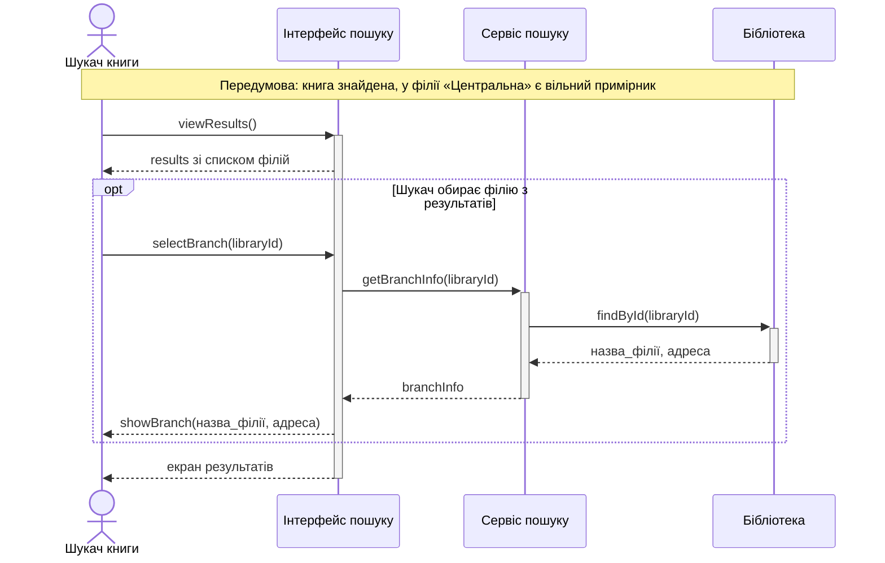

# S5: Перегляд адреси філії з вільним примірником

## Пояснення
- Перегляд адреси необов'язковий (extend до UC-1), тому його показано фрагментом opt (FR-7).
- Інтерфейс працює і до фрагмента, і після нього, тому його смуга активності не обривається.
