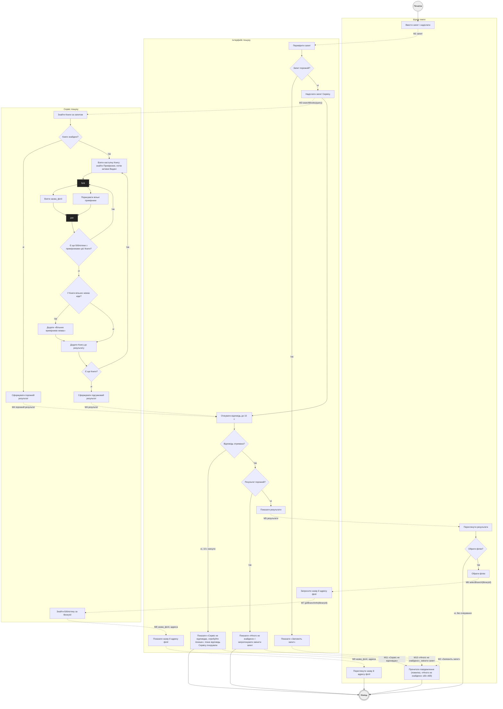

# Activity-діаграма: пошук книги у філіях

## Пояснення
- Суцільні стрілки це потік керування, пунктирні з номерами M1–M11 це повідомлення між ролями (таблиця повідомлень у spec.md).
- Розгалуження (if/else): порожній запит, відповідь отримана чи ні (таймаут 10 с), порожній результат, «вільних немає ніде», вибір філії.
- Паралельні гілки: fork після пошуку примірників і видач; `назва_філії` і підрахунок вільних виконуються паралельно, join зливає їх (для кожної Бібліотеки, як у sequence S1).
- Кінець процесу є в шести місцях: помилка запиту, таймаут, нічого не знайдено, шукач не обрав філію, перегляд адреси та підсумок.
